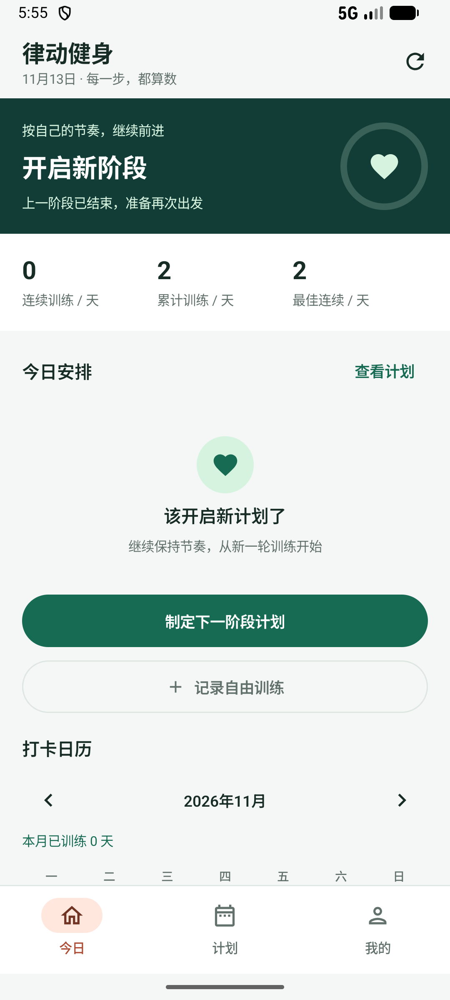
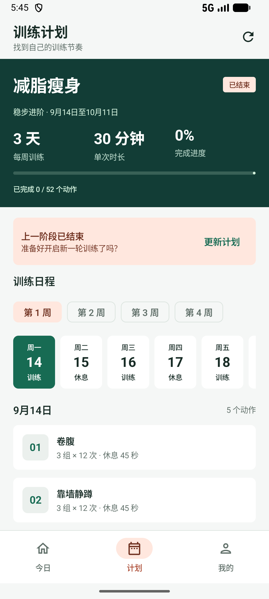
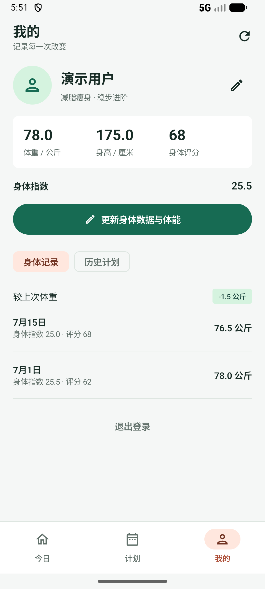
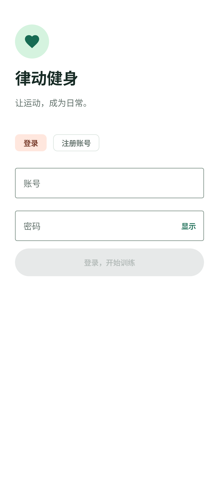
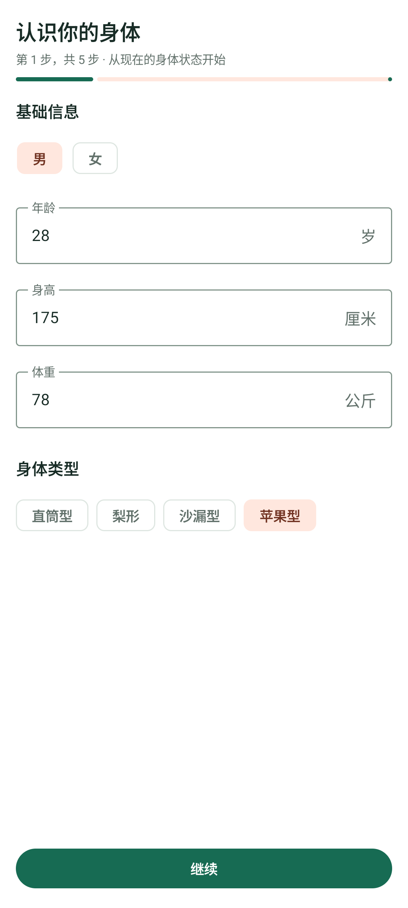

# BodyPlan App 界面更新说明

更新日期：2026-11-13。

## 打开新版

桌面显示名称为“律动健身”，包名为 `com.maou.bodyplanapp`，它就是 BodyPlan Android 项目。新版已安装到当前 `Medium Phone` 模拟器。

APK：`F:\javaWeb\毕设接单\BodyPlan\BodyPlanApp\app\build\outputs\apk\debug\app-debug.apk`。

在 Android Studio 打开 `BodyPlanApp`，选择运行配置 `app` 和设备 `Medium Phone`，点击 Run，即会构建、安装并打开这个项目。仅打开模拟器不会自动切换到 BodyPlan。

默认后端地址仍为 `http://10.0.2.2:8993/`。登录凭据见[演示验收清单](演示验收清单.md)，不再显示在 App 登录页。

## 主要变化

| 页面 | 现在展示什么 |
| --- | --- |
| 登录与注册 | 中文品牌、清晰表单、独立入口，不展示接口地址或演示密码 |
| 今日 | 今日安排、训练进度、连续天数、自由训练、月历与近期记录 |
| 计划 | 中文目标与等级、阶段进度、按周日期、当天动作、休息日 |
| 我的 | 身体数据、身体记录、历史计划、档案修改及退出登录 |
| 建档问卷 | 五步短标题、中文单位、目标建议、可返回修改 |

截图里原先的 `LOSE_FAT`、`L2`、器械代码和长段筛选过程不再直接出现在主页面。完整推荐依据保留在服务端接口，便于答辩时说明算法。

## 界面验收

以下只检查页面与取消操作，不写业务数据：

- [ ] 打开后底部是“今日、计划、我的”，图标和文字均清晰。
- [ ] 在“计划”选择第 2 周，日期随周变化；选择休息日后显示休息提示。
- [ ] “关于这份计划”可展开、收起；主页面没有长段规则代码。
- [ ] 点击“更新计划”，弹出确认；点“再想想”后旧计划保留。
- [ ] 点击“记录自由训练”，可见时长、感受和备注；空时长不能提交，取消可返回。
- [ ] 在“我的”查看身体记录和历史计划，修改档案后取消可返回原页。
- [ ] 调大字体后页面可滚动，底部导航与按钮文字不重叠。

完整业务彩排请按[演示验收清单](演示验收清单.md)执行。当前旧账号计划结束于 **2026 年 10 月 11 日**，显示“已结束”属于预期。需要演示当天训练时，请自行按清单准备有效计划。

## 实机截图

截图来自 Android 模拟器真实运行界面，包含当前旧账号的真实读取结果。

### 今日

### 计划

### 我的

### 登录

### 建档

