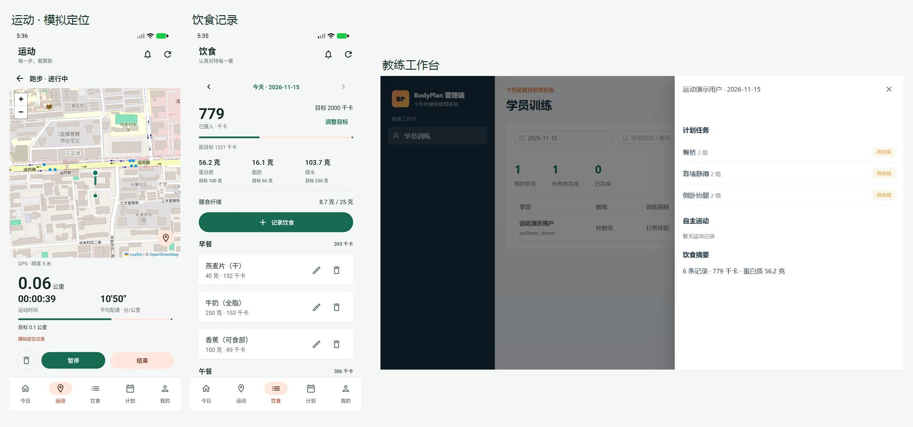

# 运动、教练与饮食：第一版验收说明

交付日期：2026-11-15。本版用于先看功能和交互，再根据反馈调整，不等同于户外长时实跑或正式上线验收。

## 1. 从哪里开始

| 入口 | 地址或文件 |
| --- | --- |
| 管理员 / 教练 Web | http://127.0.0.1:5174 |
| 后端健康检查 | http://127.0.0.1:8993/actuator/health |
| Android 安装包 | `BodyPlanApp/app/build/outputs/apk/debug/app-debug.apk` |
| Android 项目 | Android Studio 打开 `BodyPlanApp`，运行 `app` |
| 后端项目 | IDEA 打开 `BodyPlanApi/pom.xml` |
| 界面截图 | 本文同目录 `wellness-ui-20261115/` |

最终 APK 已覆盖安装到原有 `emulator-5584` 并启动，未清除应用数据。后端健康检查为 UP，Web 返回 200。
APK SHA-256：`06EC91842D71C695221041E967E89C333CA3930B436B5B98838EE444E339EF17`。

本 APK 默认连接 Android 模拟器宿主机 `http://10.0.2.2:8993/`，不适用于直接安装到真机后跨网络访问。
真机请在电脑局域网环境重新构建，把 IP 换成实际地址：

```powershell
.\gradlew.bat --no-daemon :app:assembleDebug "-PbodyplanApiUrl=http://192.168.1.10:8993/"
```

| 端 | 账号 | 密码 | 说明 |
| --- | --- | --- | --- |
| 手机用户端 | `wellness_demo` | `123456` | 新功能专用账号，已建档，有训练任务和饮食示例 |
| Web 教练端 | `coach_demo` | `123456` | 林教练，只管理已分配的学员 |
| Web 管理端 | `admin` | `123456` | 创建教练、分配学员、维护食物库 |

以上为本地演示凭证，不应用于公开部署。教练、管理员登录 Web，普通用户登录手机端。
示例饮食和计划日期由 SQL 首次执行日生成，不会在次日自动重置。手机和后端日期应一致；测试设备使用 Asia/Shanghai。
原有模拟器未改配置；若手机日期仍是 11 月 14 日，请在系统“日期和时间”中将时区设为北京时间，再查看 11 月 15 日的示例数据。



## 2. 本版功能

### 运动

- 手机底部增加“运动”入口，可选跑步、步行、骑行、力量训练、其他运动。
- 户外运动可设目标距离、目标配速，也可以自由运动；距离达标后可选择自动结束。
- 显示实际路线、有效距离、运动用时、平均配速；骑行显示平均速度。目标配速不代表即时配速提醒。
- 支持暂停、继续、主动结束、确认放弃；暂停时间与暂停期间的移动不计入。
- 结束后先保存在本机，再同步服务器；同步失败明确提示待同步，可进入记录重试。
- 运动中有前台服务通知，通知提供暂停、继续、结束并保存。切换 App 内页面不会结束运动。
- 如果进程被系统中断，重开后恢复为“暂停”草稿，由本人继续或结束，不伪造中断期间的路线。
- 力量和其他室内运动只计时，不采集 GPS，不显示虚构公里数或路线。
- 历史可查看最近 100 次已同步运动及本机待同步记录；每次运动独立于原每日自由打卡。

### 教练与站内提醒

- 管理员创建教练、分配或解除学员归属；每名学员当前归属一名教练。
- 教练按日期查看所辖学员的计划任务、完成数量、运动摘要和饮食摘要。
- 当天存在未完成任务时可以提醒；休息日、已完成任务、非当天不发送督促提醒。
- 提醒持久保存，用户 App 前台约每 30 秒检查，在合适时机弹窗，也可打开消息列表标记已读。
- 同一学员提醒至少间隔 1 分钟，每天最多 5 次，防止重复打扰。
- 教练不能查看非本人学员，也不能读取任何学员的精确运动路线。
- 管理员禁用账号或角色改变后，旧登录凭证立即失效。

### 饮食

- 按早餐、午餐、晚餐、加餐选食物和实际克数，支持修改、删除和历史日期查看。
- 按每 100 克的数据换算热量、蛋白质、脂肪、碳水化合物和膳食纤维。
- 可按日期设置减脂、增肌、维持阶段与自定营养目标；没有直接套用未确认的个体热量公式。
- 食物库由管理员维护，支持来源说明、上架停用；已有饮食保留录入时的营养快照。
- 缺失纤维数据明确标注，不把“未知”当成“没有纤维”。
- 初始库有 10 种基础示例食物，数据只用于功能演示与粗略估算，非权威营养数据库或医疗建议。

## 3. 建议验收顺序

### A. 手机运动流程

1. 用 `wellness_demo` 登录，进入“运动”。
2. 选择“跑步”，打开齿轮，设距离、目标配速，并选择是否达标自动结束。点取消应不应用本次修改。
3. 开始运动，允许精确定位，打开系统定位；户外等待有效 GPS 后移动。
4. 查看路线增长、用时和配速；暂停后移动一段，确认距离和用时不会继续增加。
5. 继续运动，再选择结束并保存，查看完成页和历史详情。
6. 另试步行、骑行；选择力量训练后无需路线也可以正常结束保存。
7. 可另行断网结束一场，确认有本机待同步记录；联网后重试，服务器只出现一条，不重复累计。
8. 进行中切换其他页、锁屏再回来；若被系统杀进程，重开应出现暂停草稿，不将停机时间算成运动时间。

模拟器不会因为屏幕计时就自动产生路线。需要模拟器定位路线或真实户外 GPS；请勿把模拟路线作为实跑结果展示。
本轮自动化验证写入专用账号的路线带“模拟定位验证记录”标记。

### B. 饮食流程

1. 进入“饮食”，查看示例目标、早餐与午餐。
2. 点“记录饮食”，选择米饭（熟），午餐填 150 克，保存后本条应约 174 千卡。
3. 修改到 100 克后本条应约 116 千卡；删除后合计同步减少。
4. 记录豆腐，确认纤维合计旁提示数据不完整，而不是虚报完整合计。
5. 调整当天目标，切换其他日期，确认记录和目标互不串日。
6. 管理员修改食物库热量后，旧饮食快照不应自动改变；主动编辑该饮食时才按当前食物值重新换算。

### C. 教练提醒闭环

1. Web 用 `admin` 登录，在“教练与学员”确认 `wellness_demo` 归属 `coach_demo`。
2. 退出后用 `coach_demo` 登录，查看学员列表与当天记录。
3. 对仍有任务的 `wellness_demo` 点提醒，输入短消息并发送。
4. 手机回到前台，等待一次轮询或点消息入口刷新，检查弹窗和消息列表。
5. 标记已读，刷新后不再计入未读；短时间再次提醒应收到限频提示。
6. 完成当天全部计划任务后刷新教练端，提醒应不可用。

本版是站内消息，不是短信、聊天系统或 App 关闭后的厂商推送。运动进行中不会用提醒弹窗遮挡路线。

## 4. 数据库执行记录

- 目标库：本机 MySQL `body_plan`。
- 执行前已完整备份：`.local/backups/body_plan_before_wellness_20261115.sql`。
- 已应用动作快照迁移 07、新模块迁移 08、专用演示数据 09；重复执行已验证。
- 新增 6 张表：`sport_session`、`coach_student`、`user_message`、`nutrition_food`、`diet_entry`、`nutrition_target`。
- 08 / 09 为可重复执行的增量与 `INSERT IGNORE` 示例，不清空原用户、档案、计划和打卡。
- 专用演示账号 ID 为 940001 / 940002；09 首次执行时预置 7 天计划、当天 6 条饮食及自定目标。
- 若已有同名或同 ID 的自定义账号，迁移不会覆盖；新环境请先核对冲突再使用示例数据。

## 5. 验证与证据

- 后端：`mvn -q test`，40 项通过，0 失败。包含真实 Spring Security / JWT / MySQL 的 9 项事务回滚集成测试。
- 覆盖：教练越权、账号禁用即时失效、长 ID 精度、提醒已读与限频、饮食快照换算和归属、运动去重与路线隐私。
- Android 单元测试：20 项通过，覆盖距离、暂停分段、长间隔、跳点、请求内容与中文格式。
- Android 静态检查与最终构建：`lintDebug` / `assembleDebug` 通过；Lint 0 错误、34 警告。没有通过忽略错误或生成基线绕过检查。
- Web：TypeScript 检查和生产构建通过；管理员与教练页面已在浏览器实际打开核对。
- Android 模拟器回归：15 项通过，0 失败、0 跳过。包含原有运动选择、新饮食选择、本地草稿恢复与账号隔离、真实接口登录、站内提醒已读闭环。
- 定位回归实际向 GPS 测试提供器注入位置，验证小步累计、暂停不计时计距、继续后分段、100 米达标自动结束、上传后读取服务器路线和历史。
- 地图除检查脚本与轨迹节点外，还检查截图中的路线像素；已确认在线底图、起终点、缩放控件和运动页路线实际显示。

截图保留在 `wellness-ui-20261115/`，包括手机今日、饮食、食物选择、运动目标、运动路线及 Web 教练与管理页面。

## 6. 限制与真机检查

- 地图是 Leaflet + OpenStreetMap 在线底图，没有高德密钥依赖。底图需要网络且受网络可达性影响；底图失败有提示，GPS 草稿不因此删除。
- GPS 坐标为 WGS84；并非高德/腾讯 GCJ-02 坐标，不应直接混用底图和轨迹。
- 低精度点、明显跳点、超过 30 秒的断点不会直接连线计距；这不能保证每台手机上的测距达到商业运动 App 精度。
- 磁盘约每 5 秒保存计时，定位点到达也会保存；突然断电或强制结束进程仍可能损失最后一个保存间隔。
- 轨迹仅登录本人可读取，教练只能看摘要；本地轨迹目录和登录凭证排除在系统云备份之外。
- 卸载 App、清除应用数据会丢失尚未同步的本地记录，不能把本地草稿当成云备份。
- 缺少精确定位权限或未开启系统 GPS 时会提示；无有效 GPS 的记录不会自动补出距离。
- 尚需使用者真机户外检查：锁屏 15～30 分钟、厂商省电策略、GPS 弱信号、真实跑步/骑行距离对比和网络切换。
- 首次整组 UI 测试在原 2GB Android 17 模拟器遇到系统低内存回收；后续改用独立 4GB 测试设备，不修改原模拟器配置。
- Web 构建仍有第三方注释和大文件提示，属于现有依赖/打包优化项，不阻塞本版预览。
- Android 仍保留依赖更新、图标弃用、资源清理等静态警告，本轮不做无关框架升级。

## 7. 重新启动

```powershell
# 终端一
cd BodyPlanApi
mvn spring-boot:run

# 终端二
cd BodyPlanWeb
npm run dev -- --host 127.0.0.1 --port 5174 --strictPort
```

Android Studio 打开 `BodyPlanApp`，选择目标设备并运行。没有设备时先在 Device Manager 启动模拟器；
不是通过打开某个已经安装的旧项目图标来验证新构建。

日志：后端 `BodyPlanApi/logs/`；Android Logcat 搜索 `BodyPlan` 和 `scenario=`。运行日志包含业务场景和账号/记录标识，
异常保留堆栈；不将完整路线坐标或登录令牌写到普通业务日志中。

## 8. 开发留档

| 提交 | 内容 |
| --- | --- |
| `b4d348c` | 新增需求范围与增量迁移约定 |
| `73ce5f0` | 运动、饮食、教练接口及 Web 工作台 |
| `1ef35f2` | 账号即时失效、长 ID、真实接口集成测试与演示数据 |
| `774f6f3` | Android 路线记录、饮食、教练消息及模拟器自动化验收 |

数据库备份和本地运行产物保留在忽略目录，不进入 Git；代码、SQL、说明和验收截图提交留档。本轮未推送远程。
