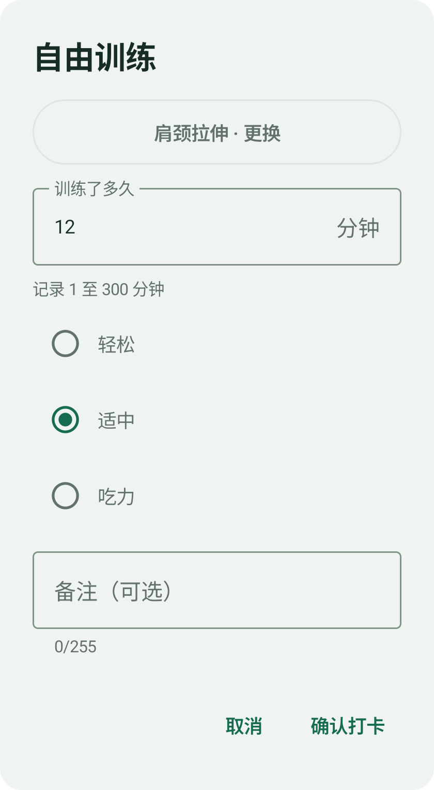

# 自选运动打卡验收说明

2026-11-13 更新。修复“自由训练只能填时长、不能选择具体运动”的缺口。

## 部署顺序

1. 在已有 `body_plan` 数据库执行 `BodyPlanApi/sql/07_checkin_exercise.sql`。脚本可重复执行，仅添加运动 ID 和名称快照字段，不删除或补造历史数据。已有 01~05 的库只需执行 07；06 是可选演示数据。
2. 重新构建并重启 BodyPlan Java 后端。必须先执行 07，再启动新版后端，否则查询新增列会报错。
3. 安装 `BodyPlanApp/app/build/outputs/apk/debug/app-debug.apk`，或在 Android Studio 运行 app。

本轮没有执行 SQL，没有新增真实打卡或修改既有记录。旧后端不支持新接口时，新 App 不会降级成丢失运动信息的旧请求。

## 新流程

“今日” → “记录自由训练” → 搜索或浏览运动 → 选择具体运动 → 填写时长、感受和备注 → “确认打卡”。

可以再次点击所选运动更换项目，已填写的反馈会保留。动作来自已上架动作库，不是固定写死的选项。列表支持搜索、加载更多、空结果和失败重试；选择后展示动作注意事项（动作库有维护时）。

服务端使用运动 ID 校验动作是否仍上架，并保存当时的运动名称快照。历史记录显示具体名称；没有名称的旧自由训练保留“自由训练”，不猜测补填。计划打卡沿用计划动作快照。

## 验收清单

- [ ] 点击“记录自由训练”后直接出现“选择运动”和搜索框。

- [ ] 搜索已有动作能找到结果；无匹配词显示空状态；分页可以继续选择。

- [ ] 关闭选择页后，未选择运动时不能确认打卡。

- [ ] 选择运动并填写 1~300 分钟后可以提交；更换运动不会清空时长和备注。

- [ ] 提交后，在“训练足迹”中能看到具体运动名、日期、时长、感受；退出重登仍保留。

- [ ] 动作被下架后提交应被拒绝，不能悄悄记成其他运动。

- [ ] 撤销自由训练，再选择不同运动打卡，记录应更新为新运动。

- [ ] 普通计划动作打卡不要求重新选择运动，已有计划打卡流程不受影响。

仍沿用原有“每天一次自由训练”的规则，本次未扩展成每日多项运动或运动计时器。对运动项目的选择不代表系统已依据个人伤病评估其适用性。

## 验证边界

后端测试使用模拟 Mapper/JdbcTemplate，Android 界面测试使用内存动作列表和提交回调，均不连接数据库写入。真实保存与重登持久化需在执行 07、启动新版后端之后按上方清单验收。

无业务写入的界面测试类为 `com.maou.bodyplanapp.ExerciseSelectionTest`；不要无过滤运行全部 Android 测试，其他闭环测试可能写入业务数据。

验证结果：后端 18 项回归测试、Android 13 项单元测试、3 项运动选择界面测试通过。APK 构建通过。一次模拟器测试构建因本机原生内存不足中断，限制 Gradle 为 768 MB、单 worker 后重跑通过。当前后端未连接，未验证真实接口持久化。

## 界面截图

以下截图使用内存测试动作，不代表数据库新增了这些动作或打卡。

